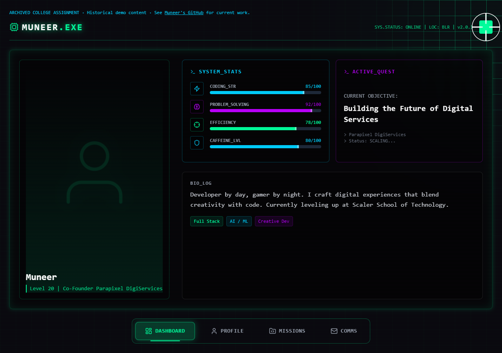
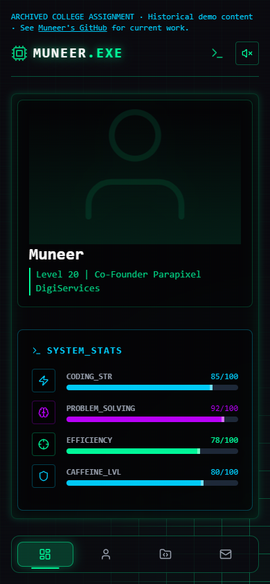

# PortfolioV2 — the portfolio as a game menu

**A college assignment exploring a different way to browse a portfolio: neon panels, a character dashboard, mission cards and a hidden terminal.**

This is an archived interface experiment, preserved for its visual and interaction ideas. It is not my current professional portfolio. For current work, start with [my GitHub](https://github.com/Muneer320).



*Real local capture. The profile text, skill levels, project cards and game statistics are historical demonstration content, not verified career facts or measured performance.*

## What you can explore

| Interaction | The idea |
| --- | --- |
| Dashboard / Profile / Missions / Comms | Treat portfolio sections as screens in a game menu |
| Cursor and spotlight | A moving crosshair and illuminated background grid |
| Sound toggle | Procedural Web Audio ambience and short interface sounds |
| Backtick terminal | Built-in commands such as `help`, `whoami`, `clear` and `game` |
| Memory mini-game | A Simon-style sequence experiment, reached through `game` |

The contact form plays a local animation. **It sends and saves nothing.** Project destinations in the sample data are `#` placeholders; the game-like scores are visual content.

## Run it locally

Install Git and Node.js **22.12+** with npm; Node 24 on Windows was used for verification. No account, environment file, backend or API key is needed.

```sh
git clone https://github.com/Muneer320/PortfolioV2.git
cd PortfolioV2
npm ci --ignore-scripts
npm run dev -- --host 127.0.0.1
```

Open the local URL Vite prints. Switch between the four screens, toggle sound, then press the backtick key and enter `help`. Use `game` to launch the memory experiment. In Comms, use sample details to preview the form animation.

<details>
<summary><strong>Phone-sized capture</strong></summary>



The central panel scrolls within the screen. Navigation uses icons at narrow widths; the keyboard-driven terminal is primarily a desktop interaction.

</details>

<details>
<summary><strong>Source and developer notes</strong></summary>

React 19 and TypeScript render the app; Tailwind CSS 4 styles it, Framer Motion animates it and Lucide supplies icons. Vite builds static files.

| Path | What to look at |
| --- | --- |
| `src/App.tsx` | Screen state, archive notice, spotlight and keyboard shortcuts |
| `src/data.ts` | Historical profile, skills and placeholder project content |
| `src/components/` | Four screens, terminal, cursor and mini-game |
| `src/context/SoundContext.tsx`, `src/utils/soundEngine.ts` | Audio state and generated sounds |
| `src/components/Contact.tsx` | Local-only form simulation |

`npm run build` runs TypeScript and creates `dist/`. Preview that output with `npm run preview -- --host 127.0.0.1`. The repository has no test script or configured CI workflow. `npm run lint` exists but currently reports four errors and three warnings in the retained assignment code; it is not presented as passing.

The production build and real Chrome checks passed: all four screens, the sound toggle's UI, local form feedback without external requests, terminal help, game launch/abort and navigation at desktop/mobile widths. Full game completion, audible output, comprehensive accessibility and the old hosted deployment were not certified. Mobile icon-only controls and terminal focus behavior need work before reuse as a maintained site.

</details>

## Archive and reuse

Built by [Muneer Alam](https://github.com/Muneer320) as a college assignment. This repository is archived, with no ongoing maintenance or live deployment promise. The former hosted portfolio URL is intentionally omitted because its current content and deployment were not verified.

The earlier README claimed MIT, but there is no license file or package license declaration in this source tree. No new license is asserted here. Read and learn from the code; ask the author about permission before redistributing or reusing it. Preserve the author credits and the assignment's historical context.
